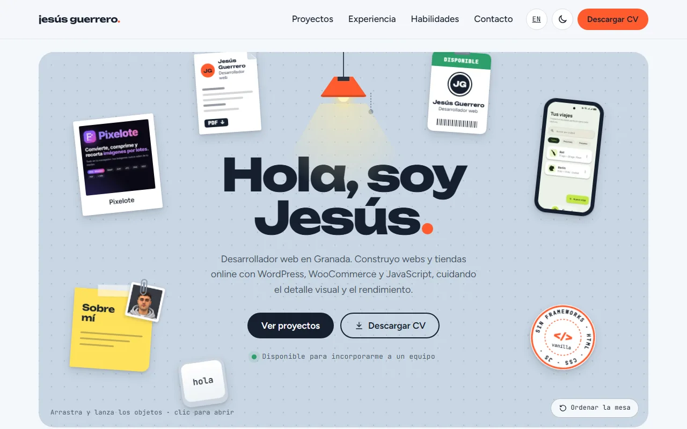
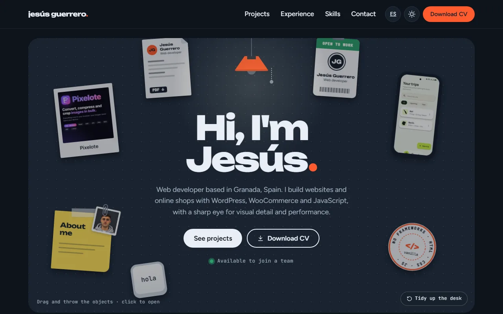

<div align="center">

# 🗂️ jesús guerrero.

**Portfolio personal de Jesús Guerrero, desarrollador web en Granada.**<br>
Una mesa de trabajo interactiva: arrastra los objetos, lánzalos, haz que choquen y ábrelos para descubrir cada proyecto.

[**Ver la web →**](https://portfolio-jesus-guerrero.vercel.app) &nbsp;·&nbsp; [English version](https://portfolio-jesus-guerrero.vercel.app/en/) &nbsp;·&nbsp; [CV](https://portfolio-jesus-guerrero.vercel.app/cv/)





</div>

---

## ✨ Qué tiene de especial

Está hecho **a mano con HTML, CSS y JavaScript**, sin frameworks, sin librerías y sin paso de compilación. Todo lo que ves se dibuja con CSS y SVG, y la física está escrita desde cero.

| | |
|---|---|
| 🖐️ **Mesa con física** | Los objetos se arrastran y se lanzan con inercia, rebotan en los bordes y **chocan entre sí** transmitiendo su velocidad. Funciona con ratón, lápiz y táctil (Pointer Events). |
| 💡 **Lámpara = modo oscuro** | Tira de la cadena de la lámpara y la mesa se queda a oscuras, con un foco de luz que sigue al cursor. Sin parpadeo al cargar. |
| 🗃️ **Cajón secreto** | Un tirador en el borde de la mesa abre un cajón con lo personal… y una pista. |
| ⌨️ **Terminal oculta** | Pulsa <kbd>º</kbd> (o <kbd>`</kbd>) y escribe `help`. Historial, autocompletado con <kbd>Tab</kbd> y algún easter egg (`sudo contratar`). |
| 📌 **Contacto en un corcho** | Clava una nota y se abre tu programa de correo con el mensaje listo. Sin servidor ni formularios de terceros. |
| 📄 **CV imprimible** | [`/cv/`](https://portfolio-jesus-guerrero.vercel.app/cv/) se monta con los mismos datos de la web y se guarda como PDF en una página A4. |
| 🔊 **Sonido opcional** | Papel, plástico y metal sintetizados con Web Audio, sin archivos. Desactivado por defecto. |
| 🧑‍💻 **"Cómo está hecha"** | La ficha del sello *Sin frameworks* enseña el código de la física, comentado. |

Y lo que no se ve:

- 🌍 **Español e inglés** como páginas separadas e indexables (`hreflang`, `canonical`).
- ♿ **Accesible**: cada objeto es un `<button>`, se abre con <kbd>Enter</kbd>, foco visible, fichas en `<dialog>` y respeta `prefers-reduced-motion`.
- ⚡ **Ligero**: imágenes en WebP, fuentes alojadas en la propia web (sin Google Fonts) y un bucle `requestAnimationFrame` que se detiene solo cuando no hay nada moviéndose.
- 🍪 **Sin cookies de terceros**: solo guarda en el navegador las preferencias imprescindibles. Banner de cookies y textos legales incluidos.

## 🧱 Estructura

```
├── index.html, en/index.html      Portada (ES / EN)
├── proyectos/, en/projects/       Todos los proyectos con filtros
├── cv/, en/cv/                    CV imprimible
├── aviso-legal/, privacidad/, cookies/  (+ versiones /en/)
├── css/
│   ├── base.css        Variables, tema claro/oscuro, botones
│   ├── desk.css        La mesa, sus objetos y la lámpara
│   ├── sheet.css       Fichas y galerías
│   ├── components.css  Proyectos, experiencia, habilidades
│   └── extras.css      Corcho, cajón y terminal
├── js/
│   ├── main.js         Arranque
│   ├── desk.js         Física de la mesa (arrastre, inercia, choques)
│   ├── sheet.js        Fichas en <dialog> con galería y ficha tipo Google Play
│   ├── terminal.js     Terminal oculta
│   ├── sound.js        Sonidos con Web Audio
│   └── data/           ✏️ Todo el contenido: proyectos, experiencia, habilidades…
├── img/, fonts/
└── vercel.json         Web estática, sin build
```

> **Para cambiar el contenido no hace falta tocar el código**: proyectos, experiencia, formación, habilidades, CV y textos personales están en [`js/data/`](js/data/), comentados campo a campo.

## 🚀 En local

No hay dependencias que instalar. Solo hace falta [Node.js](https://nodejs.org) para el servidor de desarrollo, que sirve los archivos sin caché:

```bash
node servidor-dev.mjs
# → http://localhost:5600
```

También vale cualquier servidor estático (por ejemplo, Live Server de VS Code). Abrir `index.html` con doble clic no funciona, porque los módulos de JavaScript necesitan un servidor.

## 📦 Despliegue

Se publica en **Vercel** como web estática ([`vercel.json`](vercel.json): sin instalación ni compilación).

## 👥 Contribuidores

<table>
  <tr>
    <td align="center">
      <a href="https://github.com/IamYisuSB"><br><b>Jesús Guerrero</b></a><br>
      <sub>Idea, diseño, contenido y desarrollo</sub>
    </td>
    <td align="center">
      <a href="https://claude.com/claude-code"><br><b>Claude</b></a><br>
      <sub>Asistente de programación (Claude Code)</sub>
    </td>
  </tr>
</table>

## 📬 Contacto

¿Buscas a alguien para tu equipo? **[jesusgs@ik.me](mailto:jesusgs@ik.me)** · [LinkedIn](https://www.linkedin.com/in/jesusdavid03/) · [GitHub](https://github.com/IamYisuSB)

---

<sub>© 2026 Jesús Guerrero. El código de esta web se comparte para que se pueda ver cómo está hecha; las capturas, logos y marcas de los proyectos pertenecen a sus respectivos propietarios.</sub>
